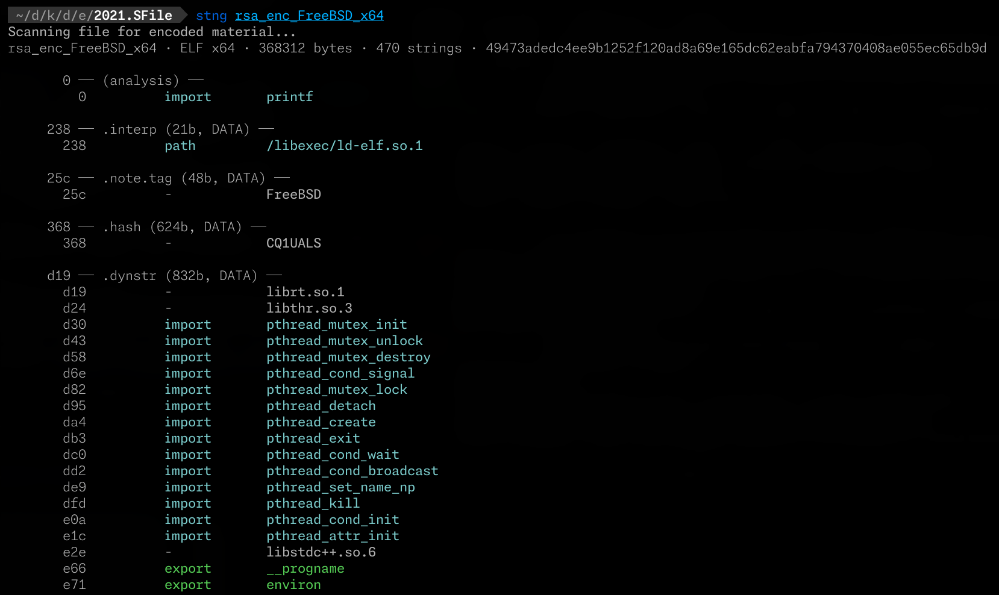

# stng

[](https://github.com/atomdrift-project/stng/releases/latest) [](LICENSE)

`strings(1)` for malware analysis. stng finds plain, encoded and XOR-obfuscated
strings, understands Go and Rust binaries, and flags URLs, IPs, commands and
suspicious paths.

<p align="center"></p>

## Install

```bash
brew install atomdrift-project/tap/stng
# or, with Rust 1.97+ and a C compiler:
cargo install --locked --git https://github.com/atomdrift-project/stng
```

`cargo install` does not read the repository's `.cargo/config.toml`, which
tunes jemalloc for a short-lived process (26-55% lower peak memory). To get the
same build, set it yourself:

```bash
JEMALLOC_SYS_WITH_MALLOC_CONF=narenas:4,dirty_decay_ms:0,muzzy_decay_ms:0 \
  cargo install --locked --git https://github.com/atomdrift-project/stng
```

Optional: [Rizin](https://rizin.re/) or [radare2](https://rada.re/n/) finds more strings and enables `--xorscan`; `--no-rizin` turns it off.

## Use

```bash
stng malware.bin              # strings by section, XOR detection on
stng -i malware.bin           # skip raw-scan noise
stng --json malware.bin       # machine-readable output
stng --xor 0xAB malware.bin   # decode with a known key: 0x/hex: for hex, else text
stng --xorscan malware.bin    # slow multi-byte XOR search
stng --json samples/          # one {"path", "strings"} JSON object per line
```

## JSON output

`stng --json` prints an array of objects; for a directory, one line per file
holding `{"path": …, "strings": [ … ]}`. Each string is:

| Field | Meaning |
|---|---|
| `value` | The string, decoded where a decoder found it. |
| `data_offset` | Where its source starts in the input file (in a fat Mach-O, the whole file). |
| `data_len` | Bytes of source, when they differ from `value`'s length: the encoded token for a decoded string, two bytes a character for UTF-16. Omitted otherwise. |
| `fragments` | For a string assembled from pieces (stack strings), each piece's `offset` and `length`. Omitted otherwise. |
| `method` | How it was found: `raw_scan`, `wide_string`, `structure` (Go/Rust `{ptr, len}`), `instruction_pattern`, `xor_decode`, `base64_decode`, `script_decode`, and the rest of `stng::StringMethod` in snake_case. |
| `kind` | What it is, or `null`: `url`, `ip`, `path`, `shell_cmd`, `base64`, `xor_key`, and the rest of `stng::StringKind` in snake_case. |

Strings decoded from a script's payload (`script_decode`) are located at the
encoded blob they came from, so several can share an offset. New `method` and
`kind` values may appear in minor releases.

## As a library

```toml
# Pin a release tag (or a `rev`); `default-features = false` leaves out the
# CLI's dependencies.
stng = { git = "https://github.com/atomdrift-project/stng", tag = "v2.1.1", default-features = false }
```

```rust
let opts = stng::ExtractOptions::new(4).with_garbage_filter(true).with_xor(None);
for s in stng::extract_strings_with_options(&bytes, &opts) {
    println!("{:#x} {:?} {}", s.data_offset, s.kind, s.value);
}
```

`stng` re-exports [goblin](https://crates.io/crates/goblin) and accepts its
parsed objects (`extract_strings_from_object`), so a caller that already parsed
a binary does not parse it twice. goblin's version is therefore part of stng's
public API.

Base64-encoded zlib text is decompressed automatically, including literals
embedded in scripts or binary files. The decoder verifies the zlib checksum
and limits both decoded input and inflated output to 10 MiB. UTF-8 and UTF-16LE
text use the `base64_decode` method; source offsets and lengths still identify the encoded
token. No sample code is executed.

## Versioning

stng follows [semantic versioning](https://semver.org/) across three surfaces:
the library API, the JSON fields above, and the command-line flags. A breaking
change to any of them, including a goblin major version, is a major release.
New `method` and `kind` values, and changes to which strings are found, are not.

## Development

See [CONTRIBUTING.md](CONTRIBUTING.md). The test fixtures include live malware
and total about 80 MB; read [testdata/README.md](testdata/README.md) first.
Security issues: [SECURITY.md](SECURITY.md).

## License

[Apache 2.0](LICENSE)
